# telaX — Arquitetura

Videoconferência **WebRTC em malha (P2P)** feita com Next.js 16, React 19 e TypeScript. O servidor **só faz sinalização**: nenhum byte de áudio, vídeo, tela ou arquivo passa por ele. Cada participante abre uma conexão direta com cada um dos outros.

> Os diagramas usam [Mermaid](https://mermaid.js.org/) e são renderizados pelo GitHub, GitLab, VS Code (extensão Markdown Preview Mermaid) e a maioria dos editores. Números e nomes vêm do código; onde há constante, o arquivo é citado.

## Sumário

1. [Visão geral](#1-visão-geral)
2. [Princípios de projeto](#2-princípios-de-projeto)
3. [Cliente](#3-cliente)
4. [Servidor e API de sinalização](#4-servidor-e-api-de-sinalização)
5. [Banco de dados e armazenamento de salas](#5-banco-de-dados-e-armazenamento-de-salas)
6. [Fluxos principais](#6-fluxos-principais)
7. [Mídia: faixas, telas e qualidade](#7-mídia-faixas-telas-e-qualidade)
8. [Estado de exibição (local de cada usuário)](#8-estado-de-exibição-local-de-cada-usuário)
9. [Implantação](#9-implantação)
10. [Segurança](#10-segurança)
11. [Constantes e limites](#11-constantes-e-limites)
12. [Testes](#12-testes)
13. [Estrutura de pastas](#13-estrutura-de-pastas)
14. [Decisões, trade-offs e limitações](#14-decisões-trade-offs-e-limitações)
15. [Consumo de requisições na Vercel](#15-consumo-de-requisições-na-vercel)
16. [Sons de entrada e saída](#16-sons-de-entrada-e-saída)
17. [Painel de administração](#17-painel-de-administração)

---

## 1. Visão geral

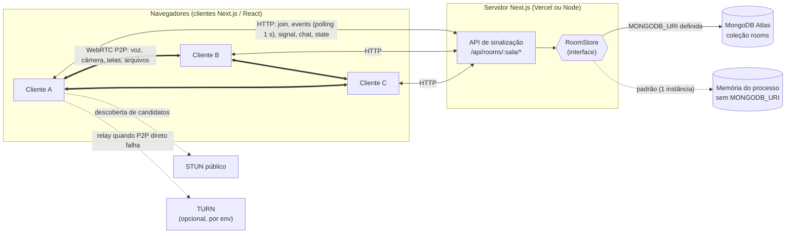

**Dois planos separados:**

| Plano | Caminho | O que trafega | Quem vê |
|---|---|---|---|
| **Sinalização** | cliente ⇄ servidor (HTTP) | quem está na sala, SDP/ICE, chat, estado (mic/câmera/telas), reinício | o servidor |
| **Mídia e dados** | cliente ⇄ cliente (WebRTC) | áudio, vídeo, telas compartilhadas, arquivos (DataChannel) | só os pares |

O chat passa pelo servidor (é sinalização); os **arquivos não**.

---

## 2. Princípios de projeto

- **Sem SFU, sem servidor de mídia.** Malha completa: com N pessoas, cada uma envia N−1 fluxos. Confortável até poucas pessoas; **não há limite fixo de participantes** (opcional por `MAX_PEERS`), mas o custo cresce com o quadrado do número de pessoas (ver [seção 15](#15-consumo-de-requisições-na-vercel)).
- **Servidor sem estado de processo.** Todo o estado de sala fica atrás da interface `RoomStore`; em produção serverless ele é o MongoDB, para que qualquer instância atenda qualquer requisição.
- **Sinalização por polling curto**, não WebSocket: funciona em hospedagem serverless (sem conexão longa) e simplifica o deploy.
- **Papéis fixos por par**: o **menor `peerId`** oferece, o outro só responde. Elimina ofertas simultâneas (*glare*) por construção.
- **Mídia sem renegociar**: todas as faixas possíveis (voz, câmera, até 3 telas e seus sons) existem desde o início; ligar, desligar ou trocar é `replaceTrack`.
- **Preferências de exibição são locais.** Ocultar, silenciar, volume, seleção, layout e dispositivos são decisões do navegador de cada pessoa; nada disso vai ao servidor nem aos outros.
- **Lógica pura separada de efeitos.** O que decide (estado de exibição, qualidade, slots de tela, validação) é função pura, testada em Node sem navegador.

---

## 3. Cliente

### 3.1 Camadas

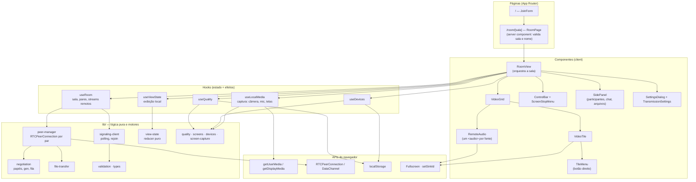

### 3.2 Responsabilidades

| Peça | Responsabilidade |
|---|---|
| `RoomView` | Une os hooks, decide qual tela mostrar (entrando, sala cheia, erro, sala), liga controles e painéis. |
| `useLocalMedia` | Abre câmera e microfone **já mutados** (`track.enabled=false`), troca de microfone sem derrubar a chamada, gerencia até 3 **slots de tela**, aplica qualidade (resolução, fps, `contentHint`). |
| `useRoom` | Cria o `signaling-client` e o `PeerManager`, mantém a lista de participantes (com estado de conexão) e os `MediaStream` remotos estáveis (câmera + até 3 telas), chat e arquivos. |
| `signaling-client` | Entra na sala, faz polling (`events`), envia sinais/chat/estado, reentra se o servidor "esquece" o peer (limite de 3 reentradas em 30 s, depois mostra erro). |
| `peer-manager` | Uma `RTCPeerConnection` por par, negociação, reconexão com backoff, reinício global, limites de envio por `RTCRtpSender`. |
| `view-state` | Reducer puro: tiles, seleção múltipla, telas abertas, silenciar, volume. Ver [seção 8](#8-estado-de-exibição-local-de-cada-usuário). |
| `RemoteAudio` | Um `<audio>` fixo por fonte de som remota (voz e som de cada transmissão). Layout, fechar e selecionar **não** o recriam, então o som não corta. |
| `VideoTile` | Um `<video>` sempre mudo; o som vem do `RemoteAudio`. Troca de fonte (câmera ⇄ tela) no mesmo elemento. |

### 3.3 Persistência no navegador

| Chave (`localStorage`) | Conteúdo |
|---|---|
| `telax:devices` | microfone e saída de áudio escolhidos (id **e** rótulo: o Chromium gera ids novos a cada carregamento) |
| `telax:quality` | resolução, fps, taxa de bits, prioridade e áudio do sistema |

Tudo em `try/catch`: janela privada ou armazenamento bloqueado só significa "vale nesta visita".

---

## 4. Servidor e API de sinalização

O servidor é um conjunto de *route handlers* do Next.js (`src/app/api/rooms/[room]/…`) sobre a interface `RoomStore`.

| Rota | Método | Autenticação | Função |
|---|---|---|---|
| `/join` | POST | — (ou `password` se a sala tiver senha) | Entra na sala; devolve `peerId`, `token`, participantes, `cursor`, `gen`, `iceServers` e `protected`. `409 room_full` só se `MAX_PEERS` estiver definido e atingido. Sala com senha: `403 password_required` / `403 wrong_password` / `429 too_many_attempts` (com `Retry-After`). |
| `/preview` | GET | — (pública) | Só `{count, closed, protected}`: a tela inicial mostra "Esta sala já existe: N pessoas…". Nunca nomes, ids nem IP. `no-store`. |
| `/password` | POST | token + **anfitrião** | `{action:'set'|'clear', password?}`: liga, troca ou remove a senha. Só a pessoa mais antiga na sala (`403 not_host` para as outras). Senha de 4 a 64 caracteres. |
| `/events` | GET (`peerId`, `token`, `since`, `wait`) | token | Entrega eventos novos desde o cursor e **renova o `lastSeen`** (é o "batimento" do peer). Com `wait` (até 8000 ms) o servidor **segura a resposta** até haver evento ou o prazo (espera longa). |
| `/signal` | POST | token | Repassa SDP/ICE. Aceita um item (`to`, `data`) ou um **lote** `items` de 1 a 50, validado por inteiro antes de aplicar. |
| `/chat` | POST | token | Mensagem para todos. |
| `/state` | POST | token | Mic, câmera e telas ativas (`screenSlots`). |
| `/restart` | POST | token | Reinício global de conexões (incrementa `gen`). |
| `/leave` | POST | token | Sai da sala. |

Respostas de erro: `400 invalid` (corpo inválido, até 128 KB), `403` (senha da sala), `429` (tentativas demais), `409 room_full`, `410 gone` (peer ou token desconhecido, indistinguíveis de propósito).

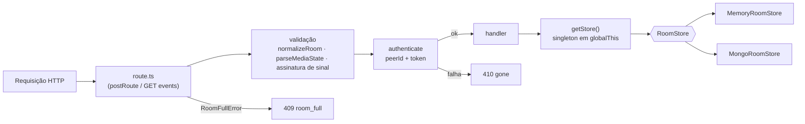

### 4.1 `RoomStore`

Interface assíncrona (`Awaitable<T>`) implementada por dois armazenamentos que passam **o mesmo conjunto de testes de contrato**:

- `join` · `leave` · `authenticate` · `events` · `signal` · `chat` · `setState` · `restart`
- `MemoryRoomStore`: `Map` em memória. Confiável só com **uma** instância.
- `MongoRoomStore`: um documento por sala, **atualizações atômicas** (um `findOneAndUpdate` por operação), seguro com várias instâncias.

`getStore()` escolhe pelo ambiente: `MONGODB_URI` definida → Mongo; senão memória.

### 4.2 Log de eventos de uma sala

Cada operação relevante vira um evento com `seq` crescente: `join`, `leave`, `state`, `chat`, `signal`, `restart`, `room` (senha ligada ou removida, payload `{protected}`, só para quem não é observador) e `admin`. O cliente pede "tudo depois do meu cursor".

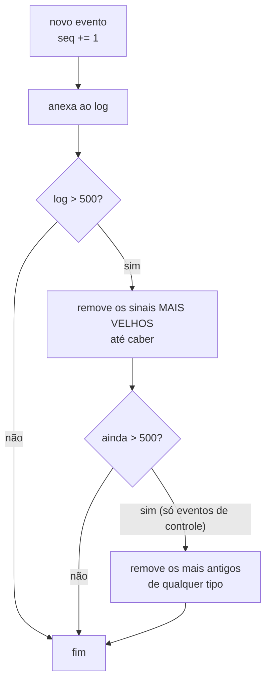

**Por quê:** sinais (SDP e candidatos ICE) são efêmeros e numerosos; com várias pessoas lotam o log em segundos. Cortar "os mais velhos" apagava os `join` de quem ainda não tinha consultado, e essa pessoa nunca mais via aqueles participantes. Entradas, saídas, estados e chat só saem se, **sem nenhum sinal**, ainda exceder.

---

## 5. Banco de dados e armazenamento de salas

Sem `MONGODB_URI` as salas ficam na memória do processo (desenvolvimento, instância única). Em serverless **é preciso** o MongoDB: instâncias diferentes não compartilham memória, e sem banco o cliente era "esquecido" a cada requisição.

### 5.1 Modelo do documento (`rooms`)

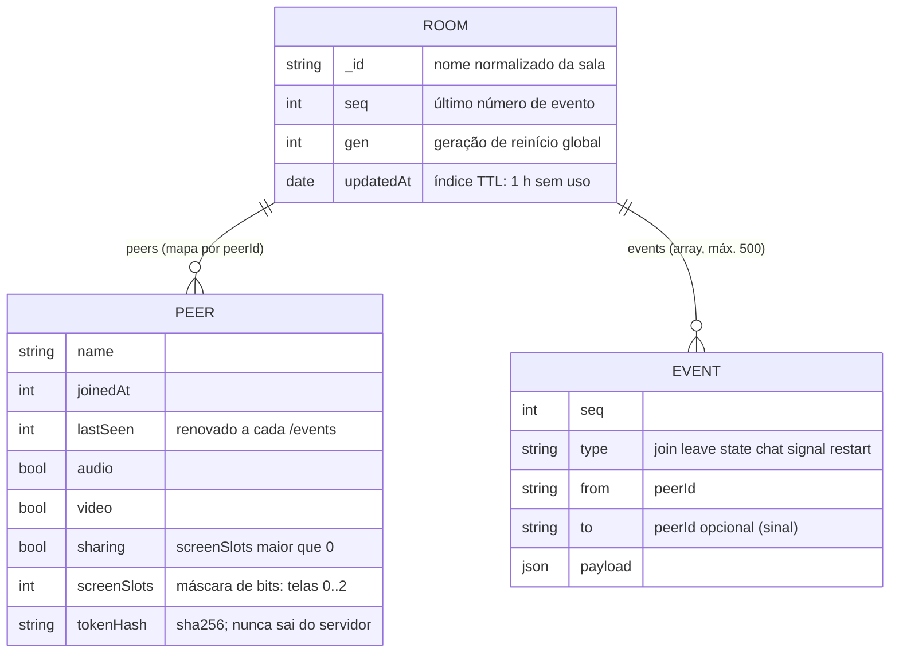

### 5.2 Decisões do armazenamento Mongo

| Tema | Decisão |
|---|---|
| Concorrência | Cada operação é **um** `findOneAndUpdate` com *pipeline* de atualização: sem leitura-modificação-escrita no cliente. |
| Limite de pessoas (opcional) | Sem `MAX_PEERS`, a entrada é um update simples. Com ele, entrada em dois passos: `ensureRoom` (upsert com `$setOnInsert`) e um update condicional com `$expr` contando peers vivos. (`$expr` não é permitido no filtro de upsert.) |
| Dados do usuário | Sempre dentro de `$literal`: uma mensagem que comece com `$` nunca é lida como caminho de campo. |
| Ids vindos do navegador | Validados como UUID antes de virarem caminho (`peers.<id>.lastSeen`). |
| Token | Guardado como `sha256`; comparado com `timingSafeEqual`. |
| Expiração de peer | `lastSeen` mais antigo que 15 s é varrido e vira evento `leave`. |
| Limpeza de salas | Sala vazia é apagada; índice **TTL** em `updatedAt` (1 h) apaga salas abandonadas. |
| Eventos antigos | Saem do log depois de 5 min, além do limite de 500 (limita o tamanho do documento, teto de 16 MB). |
| Conexões | `maxPoolSize: 5`, `maxIdleTimeMS: 10 s`: cada instância serverless abre o seu próprio pool, então ele é pequeno. |
| Senha da sala | Coleção `room_passwords` (um registro por sala, `expireAt` com TTL de 24 h desde o último uso) e `room_password_attempts` (contadores de tentativas erradas, TTL pelo `expireAt`). O registro **sobrevive à sala ficar vazia**; só guarda sal e hash scrypt. |
| Índice | `ensureIndexes()` roda na primeira criação do armazenamento; se falhar, o app segue (só a limpeza fica sem o TTL). |

**Custo:** cada chamada à API faz de 1 a 3 idas ao banco. O polling de ~1 s por participante vira carga de leitura/escrita contínua no cluster.

---

## 6. Fluxos principais

### 6.1 Entrar na sala e sincronizar

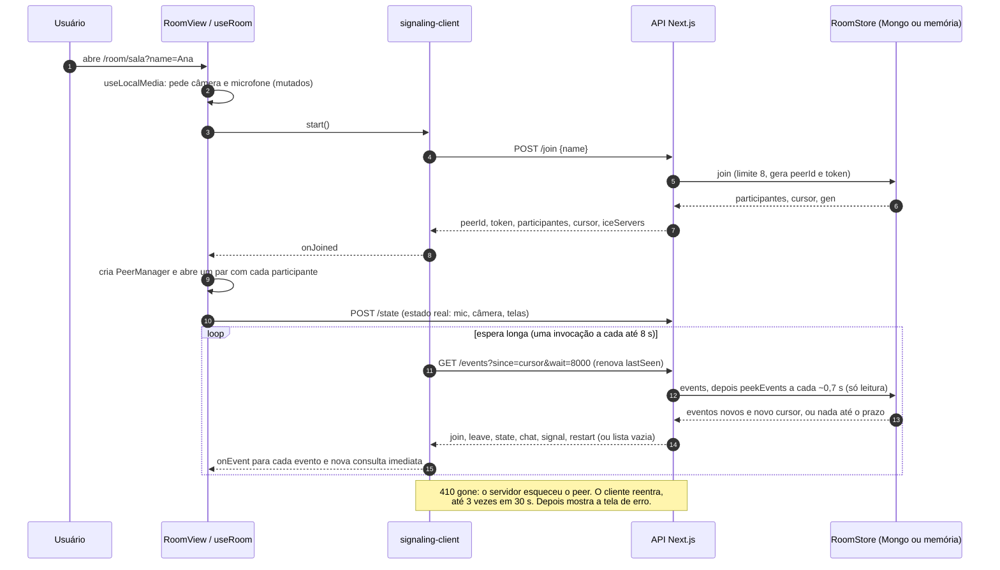

### 6.2 Negociação WebRTC (papéis fixos)

O menor `peerId` do par é o **offerer**. As mensagens de sinalização viajam pelo servidor; a mídia, direto entre os dois.

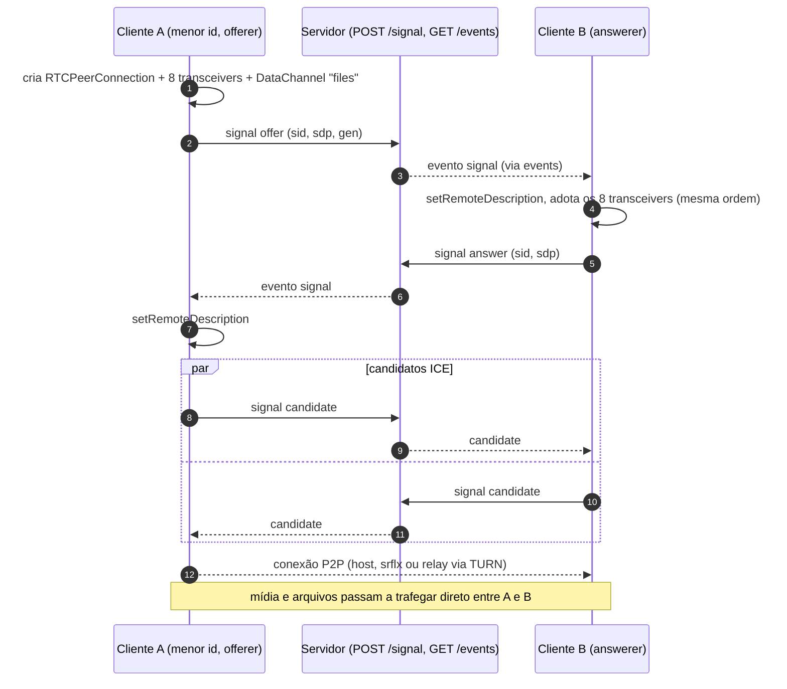

**Robustez** (em `peer-manager.ts`):

- `sid`: identifica a sessão da offer; answers e candidatos de outra sessão são descartados.
- `gen`: geração global. Sinal de geração menor que a atual pertence a uma negociação abandonada e é ignorado.
- Watchdog de 20 s: par que não conecta vira `failed` e reabre com backoff.
- `disconnected` por mais de 5 s é tratado como falha.
- Reconexão com backoff de 1 s até 30 s.

### 6.3 Estados de conexão de um par

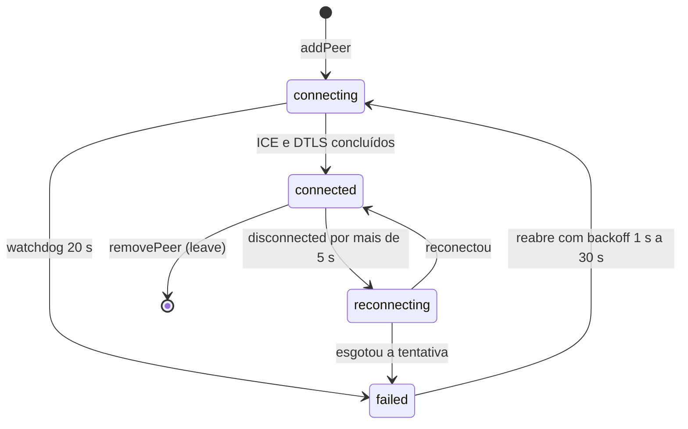

### 6.4 Reinício global de conexões

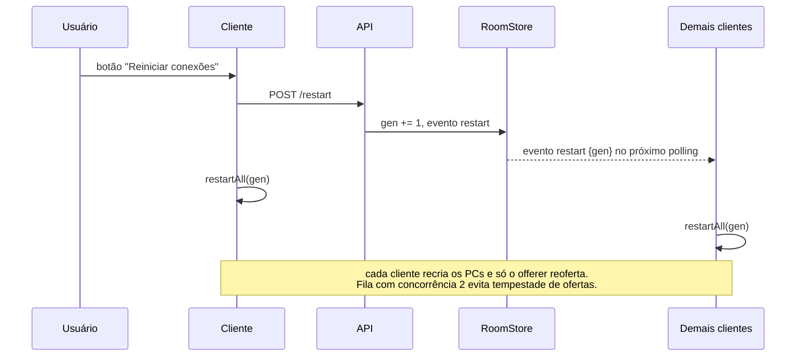

### 6.5 Arquivos

Enviados em pedaços de **16 KB** por um `RTCDataChannel` P2P (até **25 MB**), com controle de fluxo (pausa em 1 MB em buffer, retoma em 256 KB). Nunca passam pelo servidor; só chega a quem está conectado no momento do envio.

### 6.6 Prévia e senha da sala

A tela inicial consulta `GET /preview` (uma vez por pausa de 400 ms na digitação, sem polling) e mostra que a sala existe, quantas pessoas estão nela e se tem senha. A senha é ligada e desligada **de dentro da sala**, pelo **anfitrião**: a pessoa mais antiga na sala (menor `joinedAt`; empate, menor `peerId`; observadores do admin não contam). Se ela sai, o posto passa à seguinte.

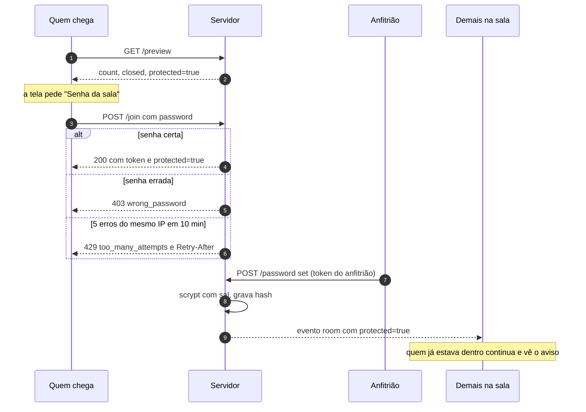

Regras: a senha só vale para **novas** entradas; nunca vai na URL (a aba a guarda em `sessionStorage` para recarregar sem pedir de novo); o servidor guarda só sal e hash scrypt, comparados com `timingSafeEqual`, e nunca devolve nem registra a senha; o observador do admin entra sem senha; sala encerrada responde `room_closed` antes de pedir senha.

---

## 7. Mídia: faixas, telas e qualidade

### 7.1 Oito transceivers por par

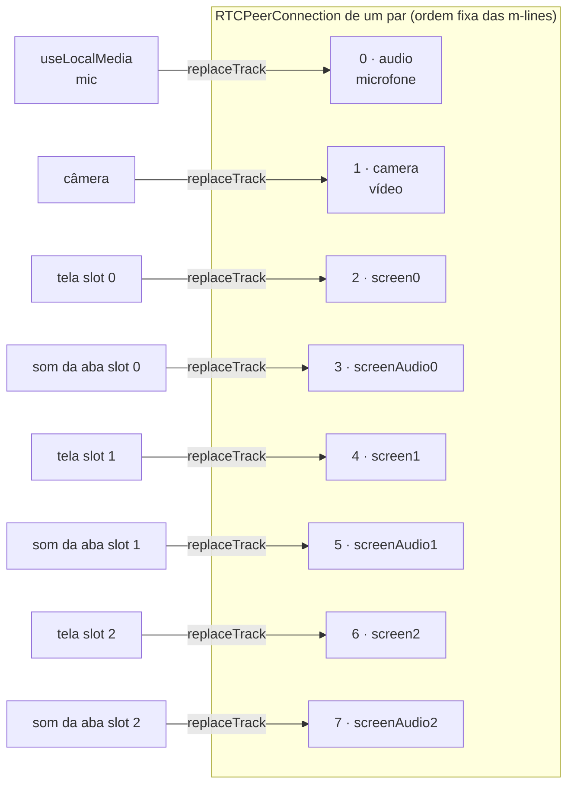

- O **offerer** cria os 8; quem responde **adota** os criados pela offer, na mesma ordem (`adoptTransceivers`).
- Ligar/desligar câmera ou mic é `track.enabled`; compartilhar ou parar uma tela é `replaceTrack` no slot, **sem renegociar**.
- Slots são **fixos** (0 a 2): parar uma tela não muda a identidade das outras. A máscara de slots ativos viaja no `/state` como `screenSlots`.
- O **som da aba** vai em faixa própria, separada do microfone.
- Slots vazios têm `sender.track = null`: geram m-lines mas nenhum RTP.

### 7.2 Qualidade do que eu envio

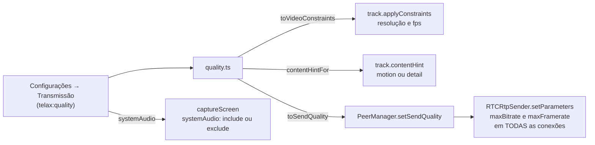

Limites por sender são reaplicados depois de cada `replaceTrack`, ao adotar transceivers e quando o par conecta (o `getParameters()` antes da negociação pode vir vazio). O envio total estimado é `taxa × (participantes − 1)`, mostrado nas Configurações.

### 7.3 Compartilhamento de tela

- Até **3 telas** por pessoa. O botão **Tela** adiciona uma; **Parar compartilhamento** pergunta qual parar (miniatura ao vivo de cada uma), ou para todas.
- `getDisplayMedia({ video, audio, systemAudio })`: por padrão `systemAudio: 'exclude'` (o áudio do sistema inclui as vozes da chamada, o que causaria eco). Há uma opção para incluí-lo ao compartilhar a tela inteira.
- Se o navegador rejeitar a opção de áudio (`TypeError`/`NotSupportedError`), a captura é refeita só com vídeo.

---

## 8. Estado de exibição (local de cada usuário)

Um **reducer puro** (`view-state.ts`) decide o que cada pessoa vê. Nada vai ao servidor.

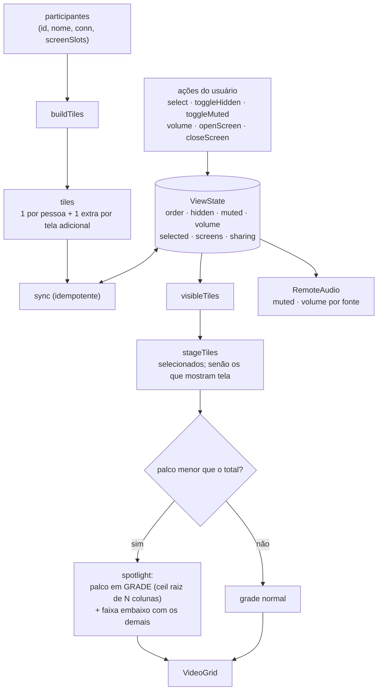

Regras que valem a pena conhecer:

- **Um tile por participante.** A tela de menor slot ocupa o lugar do avatar/câmera **no mesmo tile**; cada tela adicional vira um tile extra (`peerId#slot`). Se a câmera está ligada durante o compartilhamento, ela vira um quadro no canto.
- **Telas de outras pessoas começam fechadas e com o som da aba mutado.** Abrir não ativa o som.
- **Seleção múltipla:** clicar alterna só aquele tile; os selecionados formam, juntos, uma grade grande. A seleção aparece só como contorno.
- **Fechar a tela** volta ao avatar/câmera e para o som da aba; **fechar o tile** o manda para a faixa "Fechadas".
- **Áudio em dois grupos distintos** no menu de botão direito: **Voz de {pessoa}** e **Som da transmissão** (um por tela), cada um com silenciar e volume.
- `sync` poda estado órfão (quem saiu, tela que parou) e é idempotente: devolve o **mesmo objeto** quando nada mudou, evitando laço de renderização.

---

## 9. Implantação

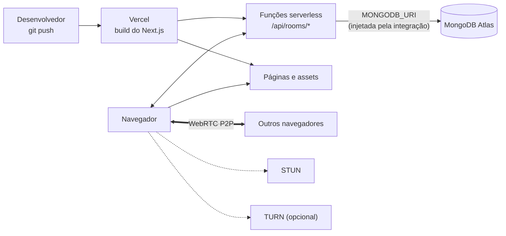

| Variável | Para que serve |
|---|---|
| `MONGODB_URI` | Guarda as salas no MongoDB. **Obrigatória na Vercel.** Sem ela, as salas ficam na memória do processo. |
| `MONGODB_DB` | Nome do banco (padrão `telax`). |
| `TURN_URLS` | URLs do TURN, separadas por vírgula (`turn:host:3478,turns:host:5349`). |
| `TURN_USERNAME`, `TURN_CREDENTIAL` | Credenciais do TURN. |
| `MAX_PEERS` | **Opcional.** Inteiro positivo que limita participantes por sala. Ausente = sem limite. |

O STUN usado é `stun:stun.l.google.com:19302`. Sem TURN, redes com NAT simétrico ou firewall restritivo podem não conectar.

No Atlas, a **Network Access** precisa permitir a Vercel (as funções não têm IP fixo, então costuma ser `0.0.0.0/0` com usuário e senha fortes).

**Nunca** versione a URI do banco: ela só vive em `.env.local` (ignorado pelo git) ou no painel da Vercel.

---

## 10. Segurança

| Ameaça | Mitigação |
|---|---|
| Alguém age como outro participante | Cada peer tem um **token secreto** (devolvido só no `join`), exigido em toda chamada; erro e peer inexistente dão o mesmo `410`. |
| Vazamento do token | No Mongo só o `sha256`; comparação com `timingSafeEqual`; o token não aparece em participantes nem em eventos. |
| Injeção no banco | Conteúdo do usuário (nome, chat, SDP) sempre em `$literal`; ids validados como UUID antes de virarem caminho de campo. |
| Corpo gigante | Limite de 128 KB; rótulos de 40 e chat de 2000 caracteres. |
| Sinal para quem não está na sala | Ignorado sem erro; remetente desconhecido dá `410`. |
| Sinal de uma negociação antiga | `gen` e `sid` descartam. |
| Sala lotada (só com `MAX_PEERS`) | O participante excedente recebe `409`, e a câmera é solta (luz apagada). |
| Adivinhar a senha da sala | Limite de **5 erros por (sala, IP) em 10 min** (tranca 5 min) e de **50 por sala** (tranca todo mundo 1 min), com `429` e `Retry-After`. Quem não é anfitrião é recusado antes do scrypt (não gasta CPU). |
| Senha da sala vazar | Só sal e hash scrypt (N=16384, r=8, p=1); comparação com `timingSafeEqual`; nunca em resposta, evento, prévia, painel do admin ou log. Parâmetros lidos do banco têm teto. |
| Mídia | Cifrada ponta a ponta pelo próprio WebRTC (DTLS-SRTP); o servidor nunca a vê. |

Limitações conhecidas de segurança: **a sala só tem senha se o anfitrião a ligar** (sem ela, quem souber o nome entra) e **não há limite de quantidade de salas**. O MIME de um arquivo recebido é o declarado por quem enviou.

---

## 11. Constantes e limites

| Constante | Valor | Onde |
|---|---|---|
| Participantes por sala | **sem limite** (opcional: variável `MAX_PEERS`) | `store.ts` |
| Espera longa do `/events` | até 8 s | `http.ts` (`MAX_WAIT_MS`) |
| Sinais por lote | 1 a 50; candidatos ICE esperam até 80 ms | `signal-validation.ts`, `signal-batcher.ts` |
| Expiração de peer sem polling | 15 s | `room-store.ts` (`PEER_TTL_MS`) |
| Eventos guardados por sala | 500 (sinais saem primeiro) | `room-store.ts` (`MAX_EVENTS`) |
| Idade máxima de evento (Mongo) | 5 min | `mongo-room-store.ts` |
| TTL de sala sem uso (Mongo) | 1 h | índice em `updatedAt` |
| Piso entre consultas vazias e rápidas | 1 s (proteção contra laço quente) | `signaling-client.ts` (`POLL_MS`) |
| Reentradas antes de desistir | 3 em 30 s | `signaling-client.ts` |
| Tolerância a `disconnected` | 5 s | `peer-manager.ts` |
| Backoff de reconexão | 1 s a 30 s | `peer-manager.ts` |
| Watchdog de sessão | 20 s | `peer-manager.ts` |
| Reinício global | fila com concorrência 2 | `negotiation.ts` (`RestartQueue`) |
| Telas por pessoa | 3 | `screens.ts` (`MAX_SCREENS`) |
| Senha da sala | 4 a 64 caracteres; registro expira 24 h após o último uso | `room-store.ts` (`PASSWORD_TTL_MS`) |
| Tentativas de senha | 5 erros/IP em 10 min → 5 min; 50 erros/sala → 1 min | `room-store.ts` (`PASSWORD_*`) |
| Espera antes da prévia | 400 ms após a última tecla | `use-room-preview.ts` |
| Tamanho máximo de arquivo | 25 MB, pedaços de 16 KB | `file-transfer.ts` |
| Corpo de requisição | 128 KB | `http.ts` |

---

## 12. Testes

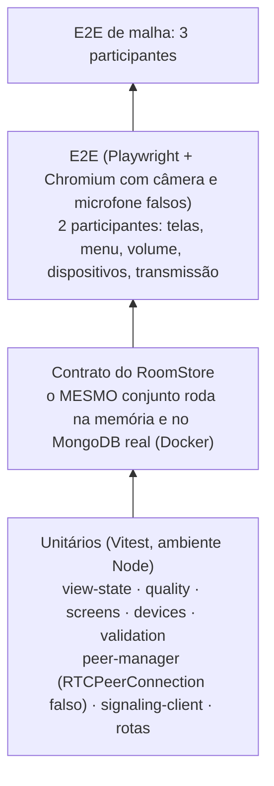

| Camada | Como roda | O que cobre |
|---|---|---|
| Unitários e contrato | `npx vitest run` | lógica pura, rotas, `PeerManager` com fakes, contrato do store em memória |
| Contrato no Mongo | `MONGODB_TEST_URI=mongodb://127.0.0.1:27018 npx vitest run` (Docker `mongo:7`) | o mesmo contrato contra um Mongo real, em banco descartável |
| E2E | `npx playwright test` | fluxos reais no navegador; lê `RTCRtpSender.getParameters()` para provar que os limites chegam ao WebRTC |
| Malha | `npx playwright test -c playwright.mesh.config.ts` | 3 participantes, reinício e saída |

**O que os testes não provam:** captura real de tela/aba e áudio do sistema (os e2e simulam `getDisplayMedia`), dispositivos de áudio reais (usam os falsos do Chromium), TURN, NAT simétrico, Safari/Firefox, e o desempenho do MongoDB Atlas sob polling.

---

## 13. Estrutura de pastas

```
src/
├─ app/
│  ├─ page.tsx                  entrada (sala e nome)
│  ├─ room/[room]/page.tsx      valida sala e nome, renderiza RoomView
│  └─ api/rooms/[room]/…        join · events · signal · chat · state · restart · leave
├─ components/                  RoomView, VideoGrid, VideoTile, TileMenu, RemoteAudio,
│                               ControlBar, ScreenStopMenu, SidePanel, SettingsDialog,
│                               TransmissionSettings, JoinForm, Icon
├─ hooks/                       useLocalMedia, useRoom, useViewState, useDevices, useQuality
├─ lib/                         signaling-client, peer-manager, negotiation, file-transfer,
│                               view-state, quality, screens, devices, screen-capture,
│                               validation, types
└─ server/                      room-store (interface), memory-room-store, mongo-room-store,
                                store (escolha por ambiente), http, ice, signal-validation
e2e/ · e2e-mesh/                testes Playwright
docs/                           esta arquitetura, specs, planos e ledger de decisões
```

---

## 14. Decisões, trade-offs e limitações

| Decisão | Por quê | Custo |
|---|---|---|
| Malha P2P, sem SFU | Zero infraestrutura de mídia; privacidade (o servidor não vê mídia) | Envio cresce com N−1; confortável só com poucas pessoas |
| Espera longa (long polling) em vez de WebSocket | Funciona em serverless; deploy simples; 8 vezes menos invocações que polling de 1 s | Uma função fica aberta até 8 s por pessoa; o banco é consultado ~1x por 0,7 s por conexão aberta |
| MongoDB como armazenamento de salas | Instâncias serverless não compartilham memória | 1 a 3 idas ao banco por chamada; custo e latência do Atlas |
| Papéis fixos (menor id oferece) | Sem *glare* | Quem tem o menor id sempre inicia |
| 8 transceivers fixos por par | Compartilhar tela sem renegociar | m-lines extras no SDP mesmo sem uso |
| Sinais são os primeiros a sair do log | Não perder entradas de participantes | Sob enxurrada, candidatos ICE antigos se perdem (há retentativa) |
| Preferências de exibição locais | Cada um organiza como quer; nada vai ao servidor | Ninguém "força" um layout para os outros |

Limitações a conhecer:

- **Sem limite de pessoas, a malha P2P não escala:** cada pessoa mantém N−1 conexões, e o total é N(N−1)/2. Medido em um só computador: 10 pessoas convergem para a malha completa em cerca de 70 s (limite de CPU da máquina de teste). Na prática, o conforto acaba bem antes de dezenas de pessoas; salas grandes pedem um SFU, que este projeto não tem.
- **Sem `MONGODB_URI`** o estado é em memória: confiável só em instância única. Na Vercel, use o MongoDB.
- O cliente **não detecta lacuna de eventos**: o cursor avança mesmo se o servidor cortou eventos (hoje isso só ocorre com mais de 500 eventos de controle).
- Chat e arquivos **não têm histórico**: quem entra depois não vê o que veio antes.
- Desligar a câmera usa `track.enabled = false` (envia quadros pretos; a luz da câmera continua acesa).
- Só o microfone e a saída de áudio podem ser trocados durante a chamada; a câmera não.
- O **som da aba** só existe se o navegador o entregar (Chrome/Edge, com a caixa de áudio marcada); o áudio do sistema depende do Windows e do modo "tela inteira".
- Não verificado em ambiente real: o consumo na Vercel (os números da seção 15 são de testes locais), MongoDB Atlas, deploy na Vercel, captura real de várias telas, 8 m-lines no SDP do Chrome, Safari e Firefox.

---

## 15. Consumo de requisições na Vercel

No plano gratuito, a cota que mais pesa é **Function Invocations (1 milhão por mês)**: cada chamada à API é uma invocação. O que consumia era o **polling de 1 s** de cada participante e **um POST por candidato ICE**.

### 15.1 O que foi feito

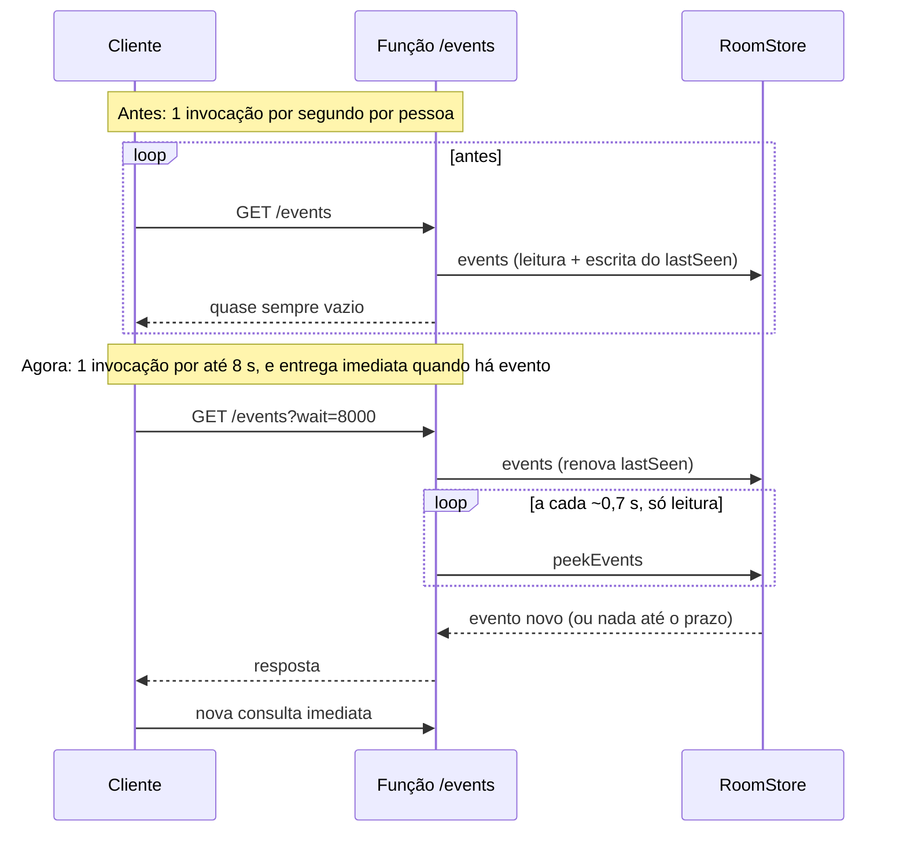

| Medida | Efeito |
|---|---|
| **Espera longa** em `/events` (`wait` até 8 s) | Sala parada: de ~3.600 para **~450 invocações por pessoa-hora**. O chat e as entradas chegam mais rápido, não mais devagar. |
| **Sinais em lote** (`/signal` com `items`) | Candidatos ICE esperam até 80 ms e vão juntos; offer e answer saem na hora. A entrada de duas pessoas caiu de ~125 POSTs de sinal para poucos. |
| `peekEvents` só leitura | A espera do servidor não escreve no banco a cada volta; o batimento (`lastSeen`) é renovado uma vez por requisição. |
| Piso de 250 ms | Servidor antigo ou erro rápido não vira laço quente. |

Números **medidos** (testes locais, `e2e/request-budget.spec.ts`): sala parada de 4 pessoas: **30 requisições por minuto no total**; entrada de 4 pessoas: 77 requisições (48 de sinal).

### 15.2 Estimativa de uso mensal

Invocações por mês ≈ pessoas × horas × 450 (sala parada) + eventos reais (entradas, chat, estado). Exemplos: 4 pessoas por 1 h ≈ 1.800; 100 horas-pessoa por mês ≈ 45.000, ou 4,5% da cota. O mesmo uso antes custava ~360.000.

### 15.3 O que ainda pesa

- **Cresce com o quadrado:** a malha P2P gera N(N−1)/2 pares, e cada par negocia por sinalização. Salas grandes consomem muito mais.
- **Atlas:** a espera longa lê o banco ~1 vez por 0,7 s por conexão aberta; as invocações da Vercel caem, as leituras no Atlas não.
- **Limite de duração:** sem Fluid compute, a função da Vercel tem 10 s no plano gratuito; a espera é de 8 s para caber. Com Fluid (como o painel do projeto indica), dá para subir a espera e reduzir mais, desde que o batimento (TTL de 15 s) seja renovado no meio da espera.

### 15.4 Próximos passos possíveis (não implementados)

1. Espera de ~20 s com renovação do `lastSeen` no meio (reduz mais ~2,5 vezes; exige Fluid).
2. Serviço de tempo real externo (Ably, Pusher, Supabase Realtime) no lugar do polling: zero invocações para sinalização, com dependência e cota próprias.
3. Cap de invocações por sala ou aviso quando a sala passa de N pessoas.

---

## 16. Sons de entrada e saída

Indicador sonoro **baixo**, sintetizado com Web Audio (sem arquivos): duas notas ascendentes ao entrar (587 → 880 Hz) e duas descendentes ao sair (740 → 494 Hz), pico de ganho 0,06 e ~0,3 s.

| Quando toca | Detalhe |
|---|---|
| Outra pessoa entra ou sai | Vários eventos de uma vez viram um toque só (sair primeiro, entrar depois). |
| Você entra | Primeira vez que o cliente fica online na sala. |
| Você clica em **Sair** | Toca antes de navegar. |
| Não toca | Para quem já estava na sala no primeiro retrato da lista, nem na reconexão silenciosa ao servidor. |

Vai para a **saída de áudio escolhida** nas Configurações (`AudioContext.setSinkId`, quando existe). Pode ser desligado em **Configurações → Áudio** ("Tocar um som baixo quando alguém entrar ou sair da sala"), lembrado em `telax:sounds`. Se o navegador mantiver o contexto de áudio suspenso (sem gesto prévio), o som simplesmente não sai.

---

## 17. Painel de administração

Tela `/admin` para o dono do site: ver as salas, **fechar** salas, mandar **mensagem** à sala (ou a todas), **expulsar** pessoas, **banir** por IP e identificador do dispositivo, **ver as câmeras e telas** ao abrir uma sala e **parar a transmissão** de uma pessoa. Só entra o usuário GitHub configurado. Contrato completo: `docs/superpowers/specs/2026-10-29-admin-design.md`.

### 17.1 Quem pode entrar (login pelo GitHub)

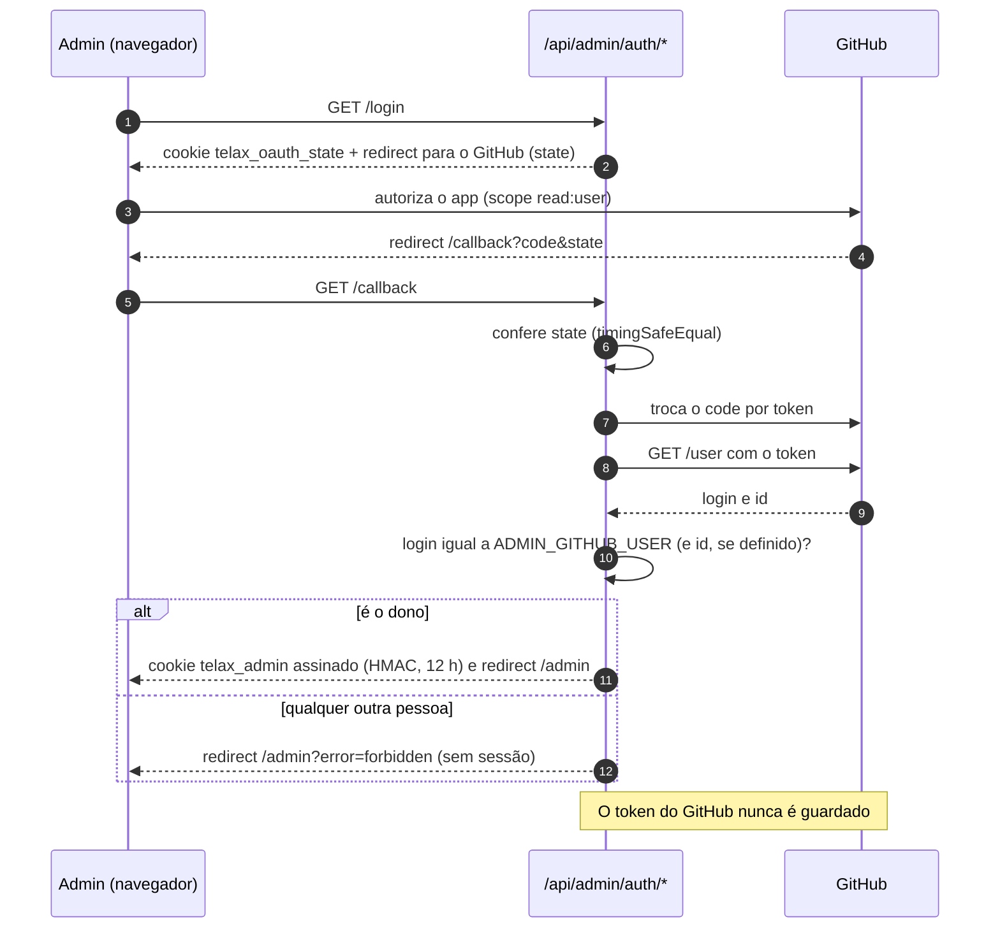

A sessão é `base64url(JSON{login,id,exp}).base64url(HMAC-SHA256)`, num cookie `HttpOnly`, `SameSite=Lax` e `Secure` em produção. **Sem as variáveis de ambiente o admin fica desligado (falha fechada)**, nunca aberto.

### 17.2 Todo endpoint de admin é protegido (negar por padrão)

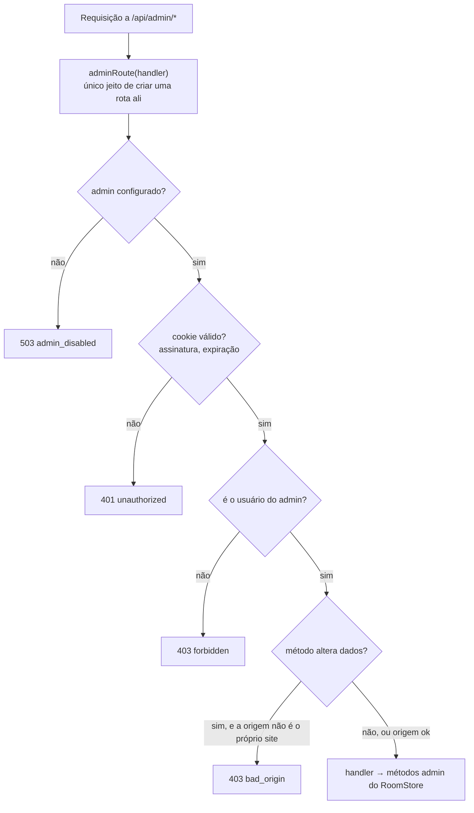

Garantias automáticas (testes):

- **Varredura estrutural:** um teste descobre todos os `route.ts` sob `src/app/api/admin`, chama cada método exportado sem sessão (exige 401), com sessão de **outro** usuário (403) e com origem estranha (403), e **falha** se algum handler não vier de `adminRoute`. Uma rota nova esquecida sem o filtro quebra a suíte.
- **E2E:** os 12 endpoints são testados contra um servidor real: sem sessão, outro usuário, segredo errado, sessão adulterada e sessão expirada.
- **Caminhos de controle fora de /api/admin:** entrar como **observador** exige sessão de admin (senão 403 e ninguém entra); o corpo do cliente não escolhe o próprio IP nem vira observador; `chat`, `state` e `signal` de clientes comuns nunca criam evento `admin`.

### 17.3 Visão geral

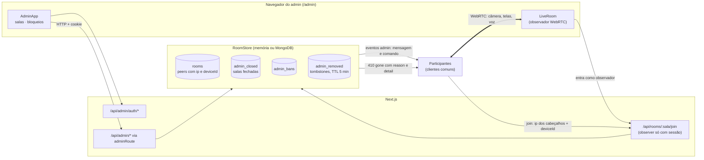

### 17.4 Poderes e como são aplicados

| Poder | Como funciona |
|---|---|
| **Ver salas** | `GET /api/admin/rooms`, atualizada a cada 5 s (pausa com a aba oculta). Mostra pessoas, observadores, criação, atividade e se está fechada. |
| **Ver câmeras e telas** | O admin entra como **observador**: um par WebRTC que só recebe. Os participantes abrem uma conexão extra para ele. O observador não aparece na lista, em tiles nem toca som, e **enquanto ele está na sala os participantes veem um aviso** ("Um administrador pode estar vendo as câmeras e telas desta sala"). |
| **Mensagem à sala ou a todas** | Evento `admin` (`from: 'admin'`) entregue a quem não é observador; o cliente mostra um banner. |
| **Expulsar** | O servidor remove o peer e grava um **tombstone** (~2 min). No próximo contato o cliente recebe `410 gone` com `reason: 'kicked'` e o texto do admin (`detail`), mostra o aviso e **nunca reentra sozinho**. |
| **Banir** | Cria bans de **IP** e de **dispositivo**, remove quem casa em qualquer sala e barra o `join` seguinte (`403 banned`). Há tela para remover bloqueios. |
| **Fechar sala** | Remove todos (`reason: 'closed'`) e marca a sala **fechada**, de forma persistente (sem o TTL de 1 h) até o admin reabrir. `join` dá `403 room_closed`. |
| **Parar transmissão** | Evento `admin` de comando (`screens`, `screen`+slot, `camera`, `mic`, `all`) ao cliente da pessoa, que obedece. |

### 17.5 Limites que o admin precisa conhecer

- **MAC address é impossível.** Navegadores não o expõem e o servidor só o enxerga em rede local. O bloqueio usa **IP + identificador do dispositivo** (UUID em `localStorage`).
- **IP compartilhado bane inocentes** (mesma rede, NAT): no teste e2e todos os navegadores têm o mesmo IP, então banir um remove todos. IP dinâmico, VPN e limpar o armazenamento do navegador **contornam** o bloqueio.
- **Parar a transmissão depende do cliente obedecer.** Um cliente adulterado pode ignorar o comando; a garantia real é **expulsar ou banir**, que é feito pelo servidor.
- **Privacidade:** o IP e o identificador do dispositivo ficam guardados no servidor enquanto a pessoa está na sala (e nos bloqueios) e só aparecem na tela de admin. O aviso de monitoramento aos participantes é intencional.
- **Custo:** cada participante envia um fluxo a mais ao observador enquanto a visão ao vivo está aberta.
